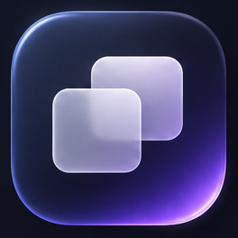
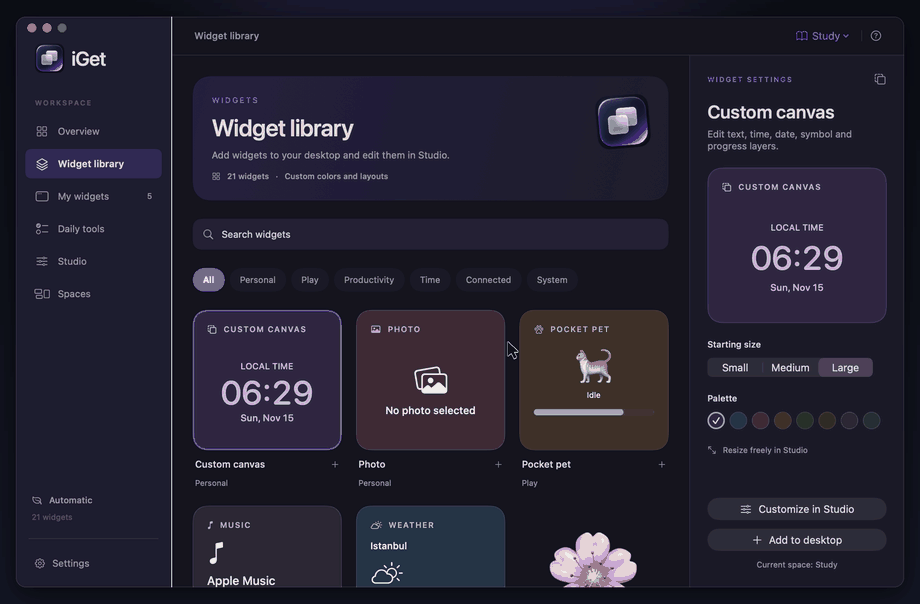

<div align="center">
  
  <h1>iGet</h1>
  <p>Native desktop widgets and workspace layouts for macOS.</p>
  <a href="https://github.com/TwoBit-Dev/iGet/releases"></a>
  
  
  <a href="LICENSE"></a>
  <br /><br />
  <a href="#overview">Overview</a> &nbsp;·&nbsp;
  <a href="#widgets">Widgets</a> &nbsp;·&nbsp;
  <a href="#installation">Installation</a> &nbsp;·&nbsp;
  <a href="#building-from-source">Build</a> &nbsp;·&nbsp;
  <a href="#license">License</a>
</div>

<br />

<p align="center">
  
</p>

## Overview

iGet is an open-source macOS application built with SwiftUI and AppKit. It runs without third-party runtime dependencies or embedded web views, and stores notes, tasks, images, and layout data locally in SQLite.

Desktop widgets sit in borderless windows with configurable placement (desktop level, normal, or floating), position locking, optional 8 pt grid snapping, and click-through mode. **Widget Studio** lets you adjust dimensions, surface material, opacity, corner radius, borders, typography, and matte color palettes (Sage, Paper, Lilac, Slate, Aurora, Peach, Sky, Rose) or custom hex colors. **Custom canvas** widgets combine movable text, symbol, time, date, and progress layers bound directly to your local tasks, focus sessions, habits, or water counter.

**Spaces** organize your desktop with curated workspace profiles (**Study**, **Developer**, and **Daily**) or custom widget arrangements that you can switch with one click from the app or menu bar, export as schema-validated `.iget.json` packs, or back up and restore from JSON. Live data sources are demand-driven: CPU, memory, and battery sampling stop when no matching widget or editor is open and pause on sleep. Weather uses Open-Meteo with a 15-minute cache, Apple Music and Spotify playback controls require explicit opt-in via macOS Automation permissions, and the interface runs in English, Turkish, and German.

## Widgets

The desktop library includes 21 widgets:

| Group | Widgets |
| --- | --- |
| **Productivity** | Tasks, Notes, Habits, Water tracker, Breathing timer |
| **Time & Focus** | Clock, Focus timer, Calendar, Countdown |
| **Personal & Canvas** | Custom canvas, Photo, Quote |
| **Connected & System** | Weather (Open-Meteo), Music (Apple Music / Spotify), Shortcuts, Battery, System monitor |
| **Desk Toys** | Pocket pet, Sticker, Dice, Noughts & crosses |

Seven local tools are also implemented as macOS Notification Center / desktop system widgets through the `iGetWidgets` WidgetKit extension.

## Installation

Prebuilt standalone archives are packaged for macOS 14 and later:

- **Apple Silicon (`arm64`):** `iGet-0.3.0-apple-silicon.zip`
- **Intel (`x86_64`):** `iGet-0.3.0-intel.zip`

Download the matching archive from [GitHub Releases](https://github.com/TwoBit-Dev/iGet/releases), verify its SHA-256 checksum against `SHA256SUMS.txt` if desired, extract `iGet.app`, and move it to `/Applications`.

<details>
<summary>First launch on macOS (ad hoc signed open-source build)</summary>
<br />

Standalone archives are ad hoc signed rather than notarized with an Apple Developer ID certificate. If Gatekeeper blocks the first launch:

1. Control-click `iGet.app` in Finder and select **Open**, or
2. Clear the download quarantine attribute in Terminal:

```sh
xattr -cr /Applications/iGet.app
open /Applications/iGet.app
```

</details>

## Building from Source

Requires macOS 14 or later and Apple Command Line Tools (`xcode-select --install`):

```sh
make local      # Build standalone ad hoc signed app for this Mac
open build/iGet.app
make packages   # Build and verify Apple Silicon and Intel release archives
make test       # Run 151 core, integration, and service checks
```

Building and installing the companion `iGetWidgets` WidgetKit extension requires full Xcode, a signing team, and the `group.com.twobitdev.iGet` App Group capability configured for both targets.

See [development documentation](docs/DEVELOPMENT.md), [connected services](docs/INTEGRATIONS.md), and the [validation record](docs/VALIDATION.md) for architecture, multi-language smoke rendering (555 views in EN, TR, DE), and test details.

## License

Distributed under the [MIT License](LICENSE).

---

<div align="center">
  <sub>iGet · macOS 14+ · MIT License</sub>
</div>
